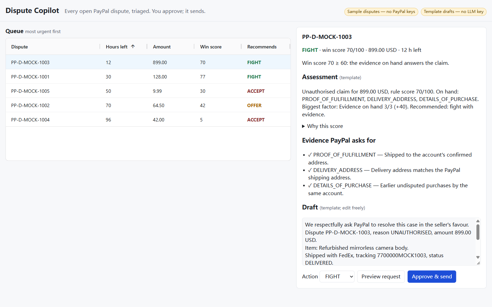

# Dispute Copilot

An AI copilot for small PayPal sellers. It pulls every open dispute from the PayPal Disputes API, ranks them by deadline and money at risk, and for each one recommends **fight with evidence**, **offer a partial refund**, or **accept** — with the score broken down, the evidence PayPal asks for, and a drafted response. Nothing reaches PayPal until the seller previews the exact request and clicks **Approve & send**.

**Live demo:** https://dispute-copilot-7vbm.onrender.com (Render free tier: first request after idle can take ~50 s)

> **Honest status:** the live demo runs against the **PayPal sandbox** (`/api/health` shows `"paypal":"sandbox"`). Its queue is real sandbox disputes on our test business account (JPY, Japan): buyer claims opened from a sandbox personal account for item not received, not as described and unauthorised, with real sandbox orders, captures and shipment trackers behind them. AI drafting (Gemini 2.5 Flash) is on only when the deploy has `LLM_API_KEY`; `"drafter":"llm"` means AI drafts, `"template"` means the deterministic fallback (also used per case when the free Gemini quota is busy), and the header badge says which. The public demo is **read-only**: Preview builds the exact PayPal request, Approve returns 403 because no `ADMIN_TOKEN` is set there. Verified against the sandbox on 2026-11-10: OAuth, dispute list and detail, capture → order → tracker facts, and one `provide-evidence` multipart submission (sent from a local run with `ADMIN_TOKEN`; PayPal answered 200 and moved the case to review). `make-offer` and `accept-claim` have been previewed against real disputes but not sent.



Built for the PayPal AI Hackathon (2026). Sandbox only: the client refuses any non-sandbox PayPal URL.

## Run it (no keys needed)

```bash
npm install
npm start          # builds, then serves http://localhost:3000
npm test           # vitest
```

Without keys the app runs on `fixtures/disputes.json` (five sample disputes) and a template drafter; badges at the top say so.

## Use your PayPal sandbox and an LLM

Copy `.env.example` to `.env` (or set the variables in your shell):

| Variable | Purpose |
|---|---|
| `PAYPAL_CLIENT_ID`, `PAYPAL_CLIENT_SECRET` | Sandbox REST app from developer.paypal.com → Apps & Credentials → Sandbox |
| `PAYPAL_BASE_URL` | Must be `https://api-m.sandbox.paypal.com` |
| `LLM_API_KEY`, `LLM_BASE_URL`, `LLM_MODEL` | Any OpenAI-compatible chat endpoint. Default: Gemini 2.5 Flash (free tier) |
| `MODE` | `mock` forces the sample disputes even when PayPal keys are set. On Render it is set in the dashboard (`render.yaml` does not pin it); the hosted demo uses `sandbox` |
| `ADMIN_TOKEN` | Required for Approve & send (header `x-admin-token`; the UI has an Unlock field that keeps it in memory only). Unset = the server refuses every write with 403 |

## Testing it as a judge

- **Hosted demo (no setup):** open the live demo. The queue shows our sandbox disputes with deadline, amount, win score, recommended action and what PayPal currently allows. Click a row for the score breakdown, evidence plan, AI assessment and draft; **Preview request** shows the exact PayPal call (path and JSON/multipart body). Cases under PayPal review are listed with "no seller action", as PayPal reports them. Sending is locked on the public server (403), so nobody can change our sandbox cases.
- **Your own sandbox, with sending:** create a sandbox REST app at developer.paypal.com (Apps & Credentials → Sandbox), set `PAYPAL_CLIENT_ID`, `PAYPAL_CLIENT_SECRET` and an `ADMIN_TOKEN` of your choice, `npm start`, and paste the token into the Unlock field. To get disputes: pay a sandbox order with your sandbox personal account, then log in to sandbox.paypal.com as that buyer and use *Report a problem* (Resolution Center) on the payment. New cases can take a few minutes to appear in the API.

## How it decides

1. **Evidence plan** — maps the dispute `reason` to PayPal `evidence_type` values and marks which ones the order facts already cover.
2. **Win score (0–100)** — a transparent rule score; every point is a labelled factor.
3. **LLM writes, code decides** — Gemini gets the code-chosen action, the score factors, the evidence plan and the facts (buyer messages fenced as untrusted data; prompt in `buildPrompt`, `server/src/drafter.ts`). It returns a one-paragraph **assessment** for the seller and the **draft** PayPal will receive, and may suggest a score nudge of at most ±15 with a reason; code clamps it and re-runs the thresholds. Successful drafts are cached per dispute state so reloads do not spend the free quota. Any model failure (HTTP error, timeout, malformed JSON) falls back to the deterministic template.
4. **Action** — FIGHT ≥ 60, OFFER 30–59 (half the amount), ACCEPT < 30 or amount under 15.
5. **Missing facts never become a silent refund** — if the order, capture or tracking cannot be read, the case is marked *insufficient facts* and routed to FIGHT-review by a human.
6. **What PayPal allows** — `status`, `allowed_response_options` and the dispute's action links decide which of the three actions can be sent; the others are disabled in the UI and refused by the server.
7. **Human gate** — preview → approve → `provide-evidence` / `make-offer` / `accept-claim`. If the model's score nudge changed the action the rules picked, the UI shows a red *AI changed recommendation — confirm* notice and Approve needs an explicit checkbox (`confirmed: true`). Approve sends exactly the last previewed request (single-use `previewId`, 10 min) and never re-runs the LLM; without a current preview it answers 409 *Preview first*.

## Safety

- Writes need `ADMIN_TOKEN`; without it the server is read-only. Per-IP rate limit on `/api`: 30 reads/min, 5 writes/min.
- PayPal calls: 15 s timeout. Reads (GET) get one retry with backoff on 429/5xx. Writes (make-offer, provide-evidence, accept-claim) are sent exactly once and never retried: on a timeout or 5xx the server answers 502 "Status unknown — verify in PayPal Resolution Center", because PayPal may already have applied it. Errors surface as `{status, reason}` with only PayPal's `name`, `message` and `details[].issue`.
- `Cache-Control: no-store` on the API; CSP (`self` only, plus `data:` for the grid's icon font), `X-Frame-Options: DENY`, `nosniff`, `Referrer-Policy: no-referrer`.
- Sandbox only: the client refuses any non-sandbox PayPal URL. In mock mode the demo resets approvals every 10 minutes.

## PayPal APIs used

`POST /v1/oauth2/token`, `GET /v1/customer/disputes` (paginated), `GET /v1/customer/disputes/{id}`, `GET /v2/payments/captures/{id}`, `GET /v2/checkout/orders/{id}`, `GET /v1/shipping/trackers/{id}`, `POST /v1/customer/disputes/{id}/provide-evidence`, `POST /v1/customer/disputes/{id}/make-offer`, `POST /v1/customer/disputes/{id}/accept-claim`.

## Stack

TypeScript, Express, AG Grid Community (dispute queue), esbuild, vitest.

## License

MIT
