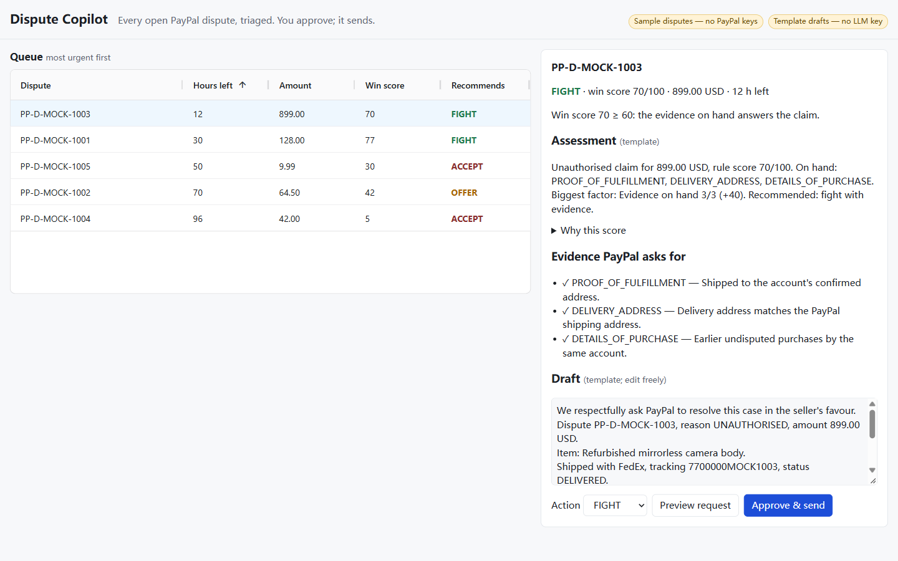

# Dispute Copilot

An AI copilot for small PayPal sellers. It pulls every open dispute from the PayPal Disputes API, ranks them by deadline and money at risk, and for each one recommends **fight with evidence**, **offer a partial refund**, or **accept** — with the score broken down, the evidence PayPal asks for, and a drafted response. Nothing reaches PayPal until the seller previews the exact request and clicks **Approve & send**.

**Live demo:** https://dispute-copilot-7vbm.onrender.com (Render free tier: first request after idle can take ~50 s)

> **Honest status:** the live demo runs in **mock mode** (five sample disputes from `fixtures/disputes.json`) until PayPal sandbox credentials are connected. AI drafting (Gemini 2.5 Flash) is on only when the deploy has `LLM_API_KEY`; check `/api/health` — `"drafter":"llm"` means AI drafts, `"template"` means the deterministic fallback, and the header badge says which. The public demo is **read-only**: Preview works, Approve returns 403 because no `ADMIN_TOKEN` is set there. The real-API code paths (OAuth, pagination, order/tracking facts, multipart evidence upload, read retries) are unit-tested against mocked PayPal responses, not yet against the live sandbox.



Built for the PayPal AI Hackathon (2026). Sandbox only: the client refuses any non-sandbox PayPal URL.

## Run it (no keys needed)

```bash
npm install
npm start          # builds, then serves http://localhost:3000
npm test           # vitest
```

Without keys the app runs on `fixtures/disputes.json` (five sample disputes) and a template drafter; badges at the top say so.

## Use your PayPal sandbox and an LLM

Copy `.env.example` to `.env` (or set the variables in your shell):

| Variable | Purpose |
|---|---|
| `PAYPAL_CLIENT_ID`, `PAYPAL_CLIENT_SECRET` | Sandbox REST app from developer.paypal.com → Apps & Credentials → Sandbox |
| `PAYPAL_BASE_URL` | Must be `https://api-m.sandbox.paypal.com` |
| `LLM_API_KEY`, `LLM_BASE_URL`, `LLM_MODEL` | Any OpenAI-compatible chat endpoint. Default: Gemini 2.5 Flash (free tier) |
| `MODE` | `mock` forces the sample disputes even when PayPal keys are set (the public demo runs this way) |
| `ADMIN_TOKEN` | Required for Approve & send (header `x-admin-token`; the UI has an Unlock field that keeps it in memory only). Unset = the server refuses every write with 403 |

## How it decides

1. **Evidence plan** — maps the dispute `reason` to PayPal `evidence_type` values and marks which ones the order facts already cover.
2. **Win score (0–100)** — a transparent rule score; every point is a labelled factor.
3. **LLM writes, code decides** — Gemini gets the code-chosen action, the score factors, the evidence plan and the facts (buyer messages fenced as untrusted data; prompt in `buildPrompt`, `server/src/drafter.ts`). It returns a one-paragraph **assessment** for the seller and the **draft** PayPal will receive, and may suggest a score nudge of at most ±15 with a reason; code clamps it and re-runs the thresholds. Successful drafts are cached per dispute state so reloads do not spend the free quota. Any model failure (HTTP error, timeout, malformed JSON) falls back to the deterministic template.
4. **Action** — FIGHT ≥ 60, OFFER 30–59 (half the amount), ACCEPT < 30 or amount under 15.
5. **Missing facts never become a silent refund** — if the order, capture or tracking cannot be read, the case is marked *insufficient facts* and routed to FIGHT-review by a human.
6. **What PayPal allows** — `status`, `allowed_response_options` and the dispute's action links decide which of the three actions can be sent; the others are disabled in the UI and refused by the server.
7. **Human gate** — preview → approve → `provide-evidence` / `make-offer` / `accept-claim`. If the model's score nudge changed the action the rules picked, the UI shows a red *AI changed recommendation — confirm* notice and Approve needs an explicit checkbox.

## Safety

- Writes need `ADMIN_TOKEN`; without it the server is read-only. Per-IP rate limit on `/api`: 30 reads/min, 5 writes/min.
- PayPal calls: 15 s timeout. Reads (GET) get one retry with backoff on 429/5xx. Writes (make-offer, provide-evidence, accept-claim) are sent exactly once and never retried: on a timeout or 5xx the server answers 502 "Status unknown — verify in PayPal Resolution Center", because PayPal may already have applied it. Errors surface as `{status, reason}` with only PayPal's `name`, `message` and `details[].issue`.
- `Cache-Control: no-store` on the API; CSP (`self` only, plus `data:` for the grid's icon font), `X-Frame-Options: DENY`, `nosniff`, `Referrer-Policy: no-referrer`.
- Sandbox only: the client refuses any non-sandbox PayPal URL. The mock demo resets approvals every 10 minutes.

## PayPal APIs used

`POST /v1/oauth2/token`, `GET /v1/customer/disputes` (paginated), `GET /v1/customer/disputes/{id}`, `GET /v2/payments/captures/{id}`, `GET /v2/checkout/orders/{id}`, `GET /v1/shipping/trackers/{id}`, `POST /v1/customer/disputes/{id}/provide-evidence`, `POST /v1/customer/disputes/{id}/make-offer`, `POST /v1/customer/disputes/{id}/accept-claim`.

## Stack

TypeScript, Express, AG Grid Community (dispute queue), esbuild, vitest.

## License

MIT
